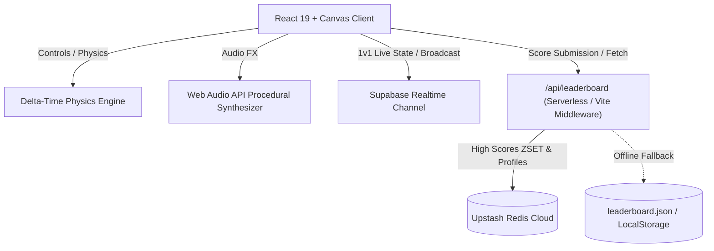

# 🐦 Flappy Bird Arcade (React + TypeScript)

[](https://react.dev/)
[](https://www.typescriptlang.org/)
[](https://vitejs.dev/)
[](https://supabase.com/)
[](https://upstash.com/)
[](https://vercel.com/)

An arcade-grade, responsive Flappy Bird game built with **React 19**, **TypeScript**, **HTML5 Canvas**, **Web Audio API**, **Supabase Realtime (1v1 Multiplayer)**, and **Upstash Redis (Global Leaderboard)**.

---

## 📑 Table of Contents

- [🚀 Quick Start](#-quick-start)
- [🎮 Controls](#-controls)
- [✨ Core Features](#-core-features)
  - [⚔️ Real-Time 1v1 Multiplayer](#️-real-time-1v1-multiplayer)
  - [🐥 Bird Skins & Custom Flyers](#-bird-skins--custom-flyers)
  - [🌆 Dynamic Atmospheric Themes](#-dynamic-atmospheric-themes)
  - [🏆 Global Leaderboard & Local Career Stats](#-global-leaderboard--local-career-stats)
  - [🏅 Medals & Milestones](#-medals--milestones)
  - [🔊 Procedural 8-Bit Web Audio Engine](#-procedural-8-bit-web-audio-engine)
- [🛠️ Architecture & Tech Stack](#️-architecture--tech-stack)
- [📂 Project Structure](#-project-structure)
- [⚙️ Environment Configuration](#️-environment-configuration)
- [⚡ Deployment Guide](#-deployment-guide)

---

## 🚀 Quick Start

### 1. Install Dependencies
```bash
npm install
```

### 2. Start Local Development Server
```bash
npm run dev
```
Open **[http://localhost:5173/](http://localhost:5173/)** in your browser. The embedded Vite dev server includes a mock leaderboard API middleware that saves scores locally to `leaderboard.json` (or uses Upstash Redis if configured).

### 3. Production Build & Linting
```bash
# Type check & build production assets
npm run build

# Run fast code linting
npm run lint

# Preview production build locally
npm run preview
```

---

## 🎮 Controls

| Action | Desktop Input | Mobile / Touch Input |
|---|---|---|
| **Flap / Jump** | <kbd>Space</kbd>, <kbd>↑</kbd>, <kbd>W</kbd>, or Mouse Click | Screen Tap |
| **Pause / Resume** | <kbd>P</kbd> or <kbd>Esc</kbd> | Pause Button in HUD |
| **Restart Game** | <kbd>Space</kbd> on Game Over screen | "PLAY AGAIN" Button |
| **Menu Navigation** | Mouse Click | Tap |

---

## ✨ Core Features

### ⚔️ Real-Time 1v1 Multiplayer
- **P2P Room System**: Create a private room with an auto-generated 6-letter room code or join an opponent's room.
- **Deterministic Obstacle Synchronization**: Both players compute identical pipe heights and gaps locally using a seeded pseudo-random number generator (`mulberry32`) derived from the room code, ensuring zero server lag or sync discrepancy.
- **Ghost Bird Rendering**: See your opponent's flyer in real-time as a semi-transparent ghost bird with interpolated physics, synchronized flapping particles, and crash animations.
- **Match Series & In-Room Rematches**: Track ongoing series wins (`YOU X - Y OPPONENT`) and trigger instant rematch countdowns directly from the game screen.
- **Powered by Supabase Realtime**: Broadcasts state at up to 40 events/sec with automated connection recovery.

### 🐥 Bird Skins & Custom Flyers
Choose from **9 distinctive flyers**, complete with unique trail particles, glow effects, and plumage styles:

| Flyer | Description | Special Attributes |
|---|---|---|
| 🐥 **Classic Flyer** | Iconic golden retro bird | Traditional arcade wing flap and cheeks |
| 👤 **Gino** | Fearless sky champ | Custom photo avatar with blue plumage and aura |
| 💎 **Jewel** | Radiant sparkling star | Custom photo avatar with pink plumage and star trail |
| 🦅 **RJ** | High-altitude flight ace | Custom photo avatar with emerald plumage and speed feathers |
| 🍊 **Junjun** | Newest face in the skies | Custom photo avatar with blazing orange crest |
| 💜 **Bongbong** | Snack-fueled sky champ | Custom photo avatar with royal purple plumage |
| ⚡ **Cyber Neon** | Futuristic synthwave drone | Glowing visor, cyan energy trail, and neon accents |
| 🔥 **Solar Phoenix** | Born from embers and solar flares | Fiery crest, orange ember particles, and flame wings |
| 🌙 **Midnight Crow** | Shadow glider of the twilight sky | Deep indigo stealth feathers and ruby gaze |

### 🌆 Dynamic Atmospheric Themes
- ☀️ **Day**: Crisp blue sky, drifting clouds, distant city silhouettes, and vibrant green pipes.
- 🌇 **Sunset**: Warm amber gradients, setting sun silhouette, and deep emerald pipes.
- 🌌 **Night**: Midnight violet tones, twinkling stars, glowing crescent moon, and neon blue pipes.

### 🏆 Global Leaderboard & Local Career Stats
- **Global Leaderboard**:
  - Top 100 high scores backed by **Upstash Redis** (`ZSET` sorted sets and `HSET` metadata profiles).
  - Interactive podium view (Gold 🥇, Silver 🥈, Bronze 🥉) with flyer avatars and time-ago timestamps.
  - Difficulty filter toggles: **All**, **Classic**, **Casual**, and **Hardcore**.
  - Automatic fallback to local persistence if offline or disconnected.
  - Arcade Gamer Tag generator & in-game tag editor.
- **Career Stats & Records**:
  - Lifetime game count and flap tracker.
  - Personal best scores recorded separately per difficulty mode.
  - Safe data reset option.

### 🏅 Medals & Milestones
Earn authentic retro arcade medals upon reaching score milestones:
- 🥉 **Bronze**: 10+ points
- 🥈 **Silver**: 25+ points
- 🥇 **Gold**: 50+ points
- 💎 **Platinum**: 100+ points
- 🎉 **Confetti Celebration**: Triggers particle fireworks upon beating your high score!

### 🔊 Procedural 8-Bit Web Audio Engine
- Built with zero external audio assets using the browser's native **Web Audio API**.
- Procedural audio synthesis for:
  - Feather flap whoosh (`sine` sweep)
  - Scoring double-chime (`sine` harmonic intervals)
  - Impact & ground crash (`triangle` / noise crunch with pitch-decay)
  - Victory fanfare chords

---

## 🛠️ Architecture & Tech Stack



- **Frontend**: [React 19](https://react.dev/), [TypeScript](https://www.typescriptlang.org/), [Vite](https://vitejs.dev/)
- **Rendering & Animation**: HTML5 `<canvas>` 2D context with sub-pixel parallax scrolling, delta-time physics, particle systems, and screen shake.
- **Styling**: Responsive Pure CSS layout (retro arcade cabinet bezel on desktop; edge-to-edge touch layout on mobile).
- **Networking**:
  - **Supabase Realtime**: Peer-to-peer 1v1 state synchronization via broadcast channels.
  - **Vercel Serverless Functions**: Node.js HTTP handler (`api/leaderboard.ts`).
  - **Upstash Redis**: Ultra-low latency sorted sets (`ZADD`, `ZREVRANGE`, `ZREVRANK`) for global leaderboards.
- **Tools**: [Oxlint](https://oxc.rs/) for high-speed linting, [Lucide React](https://lucide.dev/) for crisp arcade icons, [Canvas Confetti](https://www.npmjs.com/package/canvas-confetti) for victory FX.

---

## 📂 Project Structure

```text
flappy/
├── api/
│   └── leaderboard.ts         # Vercel serverless function for Upstash Redis leaderboard
├── public/                    # Static public assets and icons
├── src/
│   ├── assets/                # Flyer photos and images (gino, jewel, rj, junjun, bongbong)
│   ├── components/
│   │   ├── FlappyBird.tsx     # Main single-player game controller & canvas loop
│   │   ├── MultiplayerGame.tsx# 1v1 versus game loop, ghost rendering & match logic
│   │   ├── MultiplayerLobby.tsx# Room creation, code entry & matchmaking lobby
│   │   ├── MainMenu.tsx       # Start screen menu navigation
│   │   ├── HUD.tsx            # In-game score display, pause & quick controls
│   │   ├── GameOverModal.tsx  # Game over statistics, medals & quick restart
│   │   ├── LeaderboardModal.tsx# Global podium, top 100 rankings & mode filters
│   │   ├── SettingsModal.tsx  # Skin picker, theme selector, audio & difficulty
│   │   ├── StatsModal.tsx     # Lifetime career stats & per-difficulty records
│   │   ├── HowToPlayModal.tsx # Objective, controls guide & medal tiers
│   │   └── UsernameSetupModal.tsx# Gamer tag setup & arcade nickname generator
│   ├── game/
│   │   ├── audio.ts           # Web Audio API 8-bit synthesizer
│   │   ├── constants.ts       # Skins, themes, difficulty tuning & dimensions
│   │   ├── leaderboard.ts     # Client leaderboard fetch/submit & username helpers
│   │   ├── multiplayerTypes.ts# Multiplayer state types & mulberry32 seeded RNG
│   │   ├── physics.ts         # Collision detection, gravity, flap mechanics & particles
│   │   ├── renderer.ts        # Canvas rendering routines (bird, pipes, ground, background)
│   │   ├── supabase.ts        # Supabase client initialization
│   │   └── types.ts           # Game state interfaces and configurations
│   ├── hooks/
│   │   └── useMultiplayer.ts  # Supabase realtime broadcast channel hook
│   ├── App.tsx                # App entry component
│   └── main.tsx               # DOM bootstrap
├── .env.example               # Template for Upstash and Supabase environment variables
├── leaderboard.json           # Local development high score database
├── package.json               # Dependencies and build scripts
├── vercel.json                # Vercel deployment and routing rules
└── vite.config.ts             # Vite configuration with embedded dev API middleware
```

---

## ⚙️ Environment Configuration

Copy `.env.example` to `.env.local` to configure cloud databases:

```bash
cp .env.example .env.local
```

### Environment Variables

| Variable | Required | Description | Default / Fallback |
|---|---|---|---|
| `UPSTASH_REDIS_REST_URL` | Optional | REST URL for Upstash Redis database | Uses local `leaderboard.json` in dev or `localStorage` |
| `UPSTASH_REDIS_REST_TOKEN` | Optional | REST Token for Upstash Redis database | Uses local `leaderboard.json` in dev or `localStorage` |
| `VITE_SUPABASE_URL` | Required for multiplayer | Supabase project URL for 1v1 multiplayer | Multiplayer is disabled until configured |
| `VITE_SUPABASE_ANON_KEY` | Required for multiplayer | Supabase publishable client key | Multiplayer is disabled until configured |

> [!NOTE]
> The game runs offline for single-player without environment variables. Configure Supabase only after enabling Realtime authorization policies appropriate for public multiplayer; publishable client keys are expected to be visible in browser bundles.

### Security notes

- Redis credentials belong only in Vercel environment variables or an ignored `.env.local`; never commit them.
- The leaderboard API is rate-limited and validates request sizes and fields, but browser-submitted scores are not cryptographically verifiable. Do not use it for prizes or rankings with real-world value without server-authoritative score verification.
- Configure Supabase Realtime authorization policies before enabling multiplayer. Room codes are an invitation convenience, not an authentication boundary.

---

## ⚡ Deployment Guide

### Deploying to Vercel with Upstash Redis

The repository is pre-configured with [vercel.json](file:///c:/flappy/vercel.json) for instantaneous deployment to Vercel.

1. **Push to GitHub**:
   ```bash
   git add .
   git commit -m "Deploy Flappy Bird"
   git push origin main
   ```

2. **Import into Vercel**:
   - Go to [Vercel Dashboard](https://vercel.com/new) and import your repository.
   - Vercel will automatically detect Vite and set the build settings (`npm run build`, output: `dist`).

3. **Configure Environment Variables (in Vercel Project Settings)**:
   - Create a free database at [Upstash Console](https://console.upstash.com/) or via the Vercel **Storage** tab (**KV / Upstash Redis**).
   - Add the following variables:
     - `UPSTASH_REDIS_REST_URL` = your Upstash REST URL
     - `UPSTASH_REDIS_REST_TOKEN` = your Upstash REST token
     - `VITE_SUPABASE_URL` = your Supabase URL
     - `VITE_SUPABASE_ANON_KEY` = your Supabase publishable client key

4. **Click Deploy**:
   Vercel will compile the Vite frontend and host `/api/leaderboard` as a serverless edge endpoint.

---

## 📄 License

This project is open source and available under the [MIT License](LICENSE).
